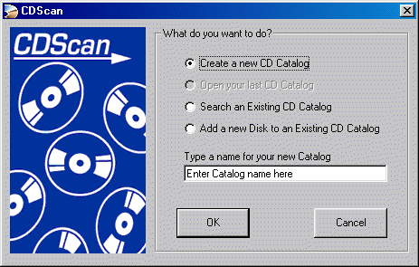
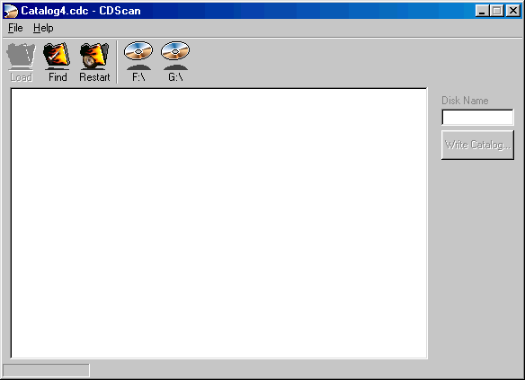

# CDScan

A free CD-R/CD-RW cataloger for Windows, written in Visual Basic 6 by Mike Monti between 1999 and 2002.

 

In the late '90s everything got backed up to CD-R, and finding one file meant feeding disc after disc into the
drive. CDScan scans a disc once and saves its file list to a catalog, so you can search every disc you own
without having any of them in the drive.

## What it does

- Create a catalog, scan a CD drive, give the disc a name and write it to the catalog
- Add more discs to an existing catalog, or reopen the last one
- Find a file across every cataloged disc
- Show a catalog in a list view: disc, path, filename, size, created and modified dates, attributes

Catalogs are plain-text `.cdc` files. The scanner walks the disc breadth-first using hidden `DirListBox` and
`FileListBox` controls, and the attribute and file-count helpers call `FindFirstFile`/`FindNextFile` directly.

## History

| Version | Released | Notes |
|---|---|---|
| 1.0b | November 1999 | First release |
| 1.1b | August 2001 | Resizable Find dialog; fixed the list not refreshing after more than 6 CDs |
| 1.2b | November 2002 | Windows 2000/XP support ("Thanks for the Patience!") |
| 2.0 | planned | Explorer-style tree view of a catalog and a better Find. Never shipped. |

CDScan was freeware, distributed from personal home pages on mminternet, EarthLink and GeoCities and listed on
shareware sites like SoftSeek and NoNags. It also turned up in several computer magazines and on dozens of shareware
CD compilations. The old home pages, rebuilt from the Wayback Machine, are at
[mike-monti.com/code/retro](https://mike-monti.com/code/retro).

## Press

PC World's Internet Tips column picked CDScan up in July 2000 ("Index CDs Quickly With CDScan", Scott Spanbauer,
p. 221):

> Fortunately, Mike Monti's free CDScan utility does perfectly what I need it to do. Insert a disc, enter a disc
> name, click the utility's Scan button, and CDScan adds the disc's directory listing to your database.

[Read the scan](https://archive.org/details/pcworld187unse?q=CDScan) on the Internet Archive. A follow-up column in
2001 ([scan](https://archive.org/details/pcworld196unse?q=CDScan)) noted "Alas, CDScan isn't being updated." Version
1.1b shipped a couple of months later.

## What's in this repo

- `src/`: the VB6 project as it stood in November 2000, the 1.0b code with early work toward 1.1 (the project
  is already versioned 1.1, but the 1.1b Find-dialog changes aren't in it yet). The 1.1b and 1.2b source
  haven't been recovered. If they turn up on an old drive, they'll land here as later commits.
- `src/CDScan.chm`, `src/CDScan.rtf`: the help file and its source.
- `docs/original/`: the freeware license that shipped with 1.0b in 1999, kept for history.
- `docs/screenshots/`: screenshots from the original CDScan web page.
- `docs/file-dates.md`: the original last-modified date of every file, since git doesn't keep them (Form2 and
  Form3 date from November 1999, Form1 from November 2000).

The original 1.0b installer and the 1.2b release are on the [Releases](../../releases) page. They're untested on
modern Windows.

## Building

Open `src/cdscan.vbp` in Visual Basic 6.0 (SP6). The project uses the Windows Common Controls 6.0
(`MSCOMCTL.OCX`) and Common Dialog (`COMDLG32.OCX`), and also references `COMCT332.OCX`. The help file path in
Project Properties is an absolute path from the original machine; point it at `src/CDScan.chm`.

VB6 needs CRLF line endings, so `.gitattributes` keeps `src/` byte-for-byte as it was saved in 2000.

## License

MIT, see [LICENSE](LICENSE). The 1999 freeware license in `docs/original/` is there for history and no longer
applies.
